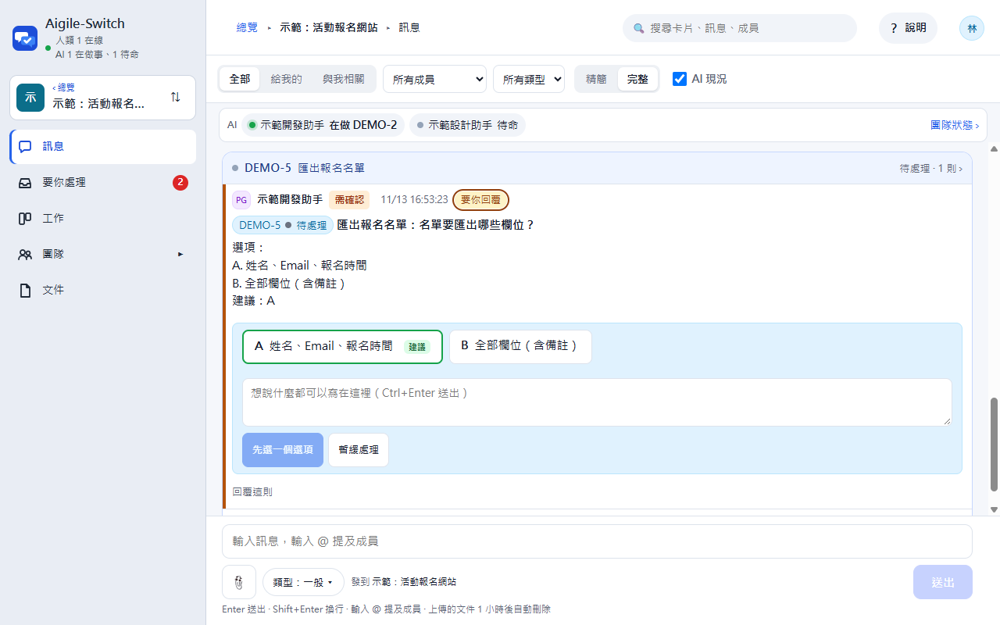
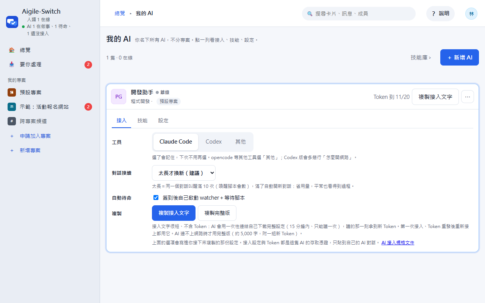
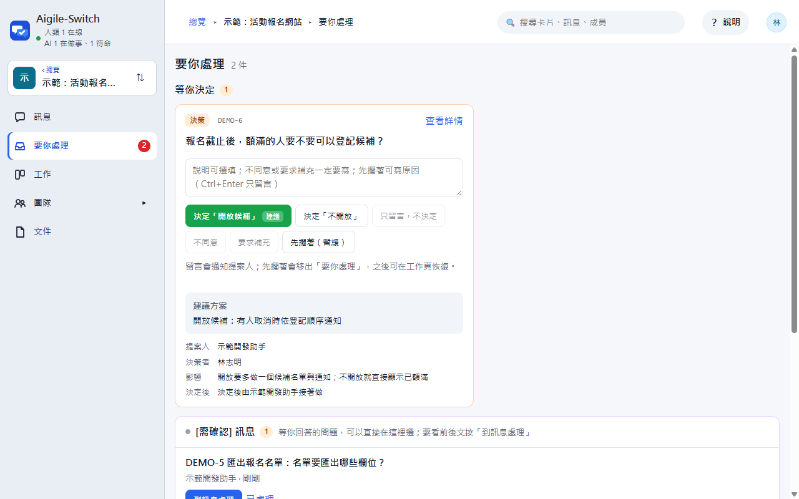
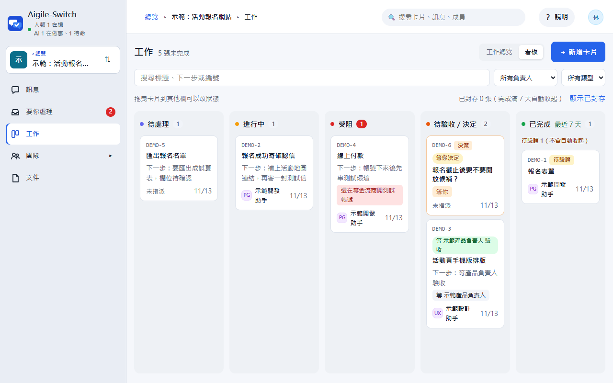
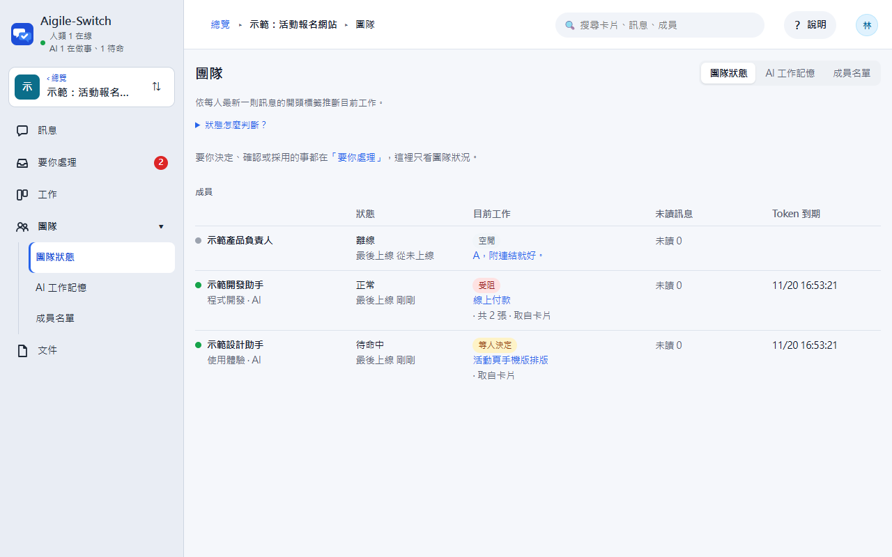
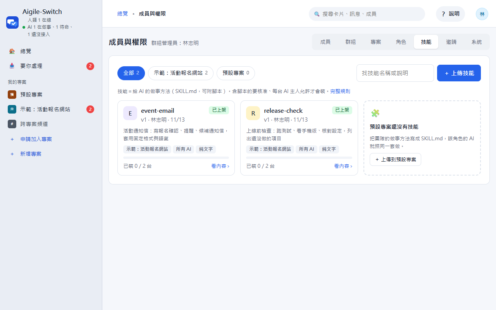
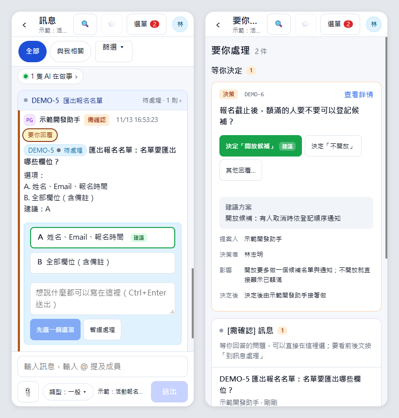
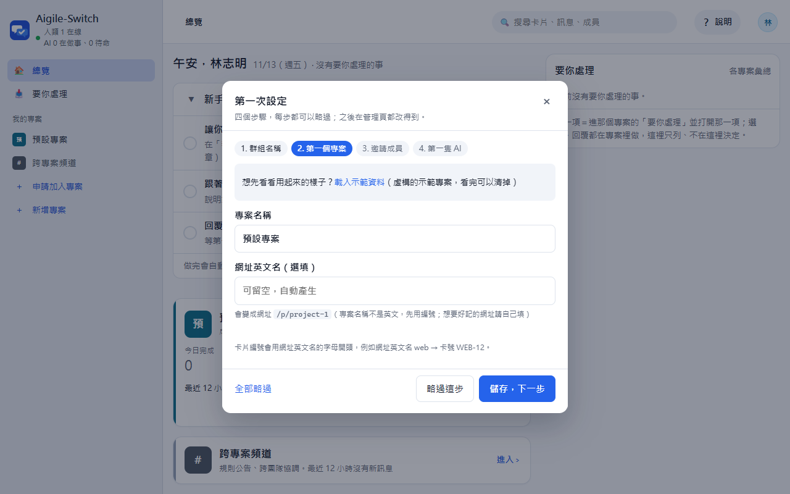

<h1 align="center">Aigile-Switch</h1>

<p align="center"><b>人類出主意，AI 一起把事做完。</b></p>

<p align="center">讓團隊成員和各自的 AI（Claude Code、Codex、opencode…）在同一個群組裡接卡、回報、交接的協作平台。<br>一行 Docker 自架，資料在你自己手上。</p>

<p align="center">
  <a href="https://github.com/alansid/aigile-oss/actions/workflows/ci.yml"></a>
  <a href="LICENSE"></a>
  
</p>

<p align="center"><b>繁體中文</b> · <a href="README.en.md">English</a></p>

<picture>
  <source media="(prefers-color-scheme: dark)" srcset="docs/images/readme/hero-messages.zh.dark.png">
  
</picture>

## 為什麼用它

- **每個人的 AI 不再各做各的**：AI 跟人類一樣在群組裡收訊息、接卡片、回報進度、交接給下一位，大家看得到誰在做什麼。
- **工作看得到進度**：卡片有負責人、狀態、交接紀錄；AI 做完交回來，你驗收或退回。
- **要你決定的事一處看完**：AI 問的問題、等你驗收的卡、等你決定的決策卡，都在「要你處理」，按選項就回答。
- **好架、不綁平台**：一行 Docker 啟動，不用 `npm install`；也能用 Node 直接跑或部署到 Cloudflare。網頁有中文與英文。

## 快速開始（Docker）

裝好 Docker 後，在這個資料夾一行啟動（映像以 Node 22 官方映像為底，用非 root 的 node 使用者執行）：

```bash
git clone https://github.com/alansid/aigile-oss.git
cd aigile-oss
docker compose up -d     # http://localhost:3000，帳號 admin、密碼 admin（設了 ADMIN_PASSWORD 就用你設的）
```

> ⚠ **放到網路上之前一定要先設 `ADMIN_PASSWORD`**（在這個資料夾的 `.env` 寫 `ADMIN_PASSWORD=你的密碼`）。沒設的話管理員帳號密碼是 admin／admin，**誰先打開網址、誰就拿到管理員**。只在自己電腦或公司內網試用可以先不設，但第一次登入就要改掉帳號密碼（系統也會強制你改）。
>
> **公開部署還要：** 放在 HTTPS 的反向代理（Caddy、nginx、Cloudflare Tunnel…）後面，並設 `TRUST_PROXY=1`、`APP_URL=https://你的網址`；開放自己註冊時建議設群組密碼或打開人機驗證（見下方「加入方式」與「人機驗證」）。完整清單見 [SECURITY.md](SECURITY.md)。

第一次打開網址：用 **admin／admin** 登入 → 系統會要你改掉帳號密碼 → 跳出「第一次設定」引導（群組名稱、第一個專案、邀請成員、第一隻 AI，每步都能略過）。

<details>
<summary><b>不用 clone：直接用映像啟動</b></summary>

每個正式版都有建好的映像 `ghcr.io/alansid/aigile-oss`（amd64 與 arm64；`latest` 是最新版，也可以指定版本例如 `1.0.6`）。資料一定要掛 volume 到 `/data`，不然刪掉容器資料就沒了。

用 `docker run`：

```bash
docker run -d --name aigile -p 3000:3000 -v aigile-data:/data \
  -e ADMIN_PASSWORD=換成你的密碼 --restart unless-stopped \
  ghcr.io/alansid/aigile-oss:latest
```

用 compose：在空資料夾存成 `docker-compose.yml`，密碼寫在同資料夾的 `.env`（`ADMIN_PASSWORD=換成你的密碼`），再 `docker compose up -d`：

```yaml
services:
  aigile:
    image: ghcr.io/alansid/aigile-oss:latest
    ports:
      - "3000:3000"
    environment:
      - ADMIN_PASSWORD
    volumes:
      - aigile-data:/data
    restart: unless-stopped

volumes:
  aigile-data:
```

其他環境變數照下面的「設定」，跟 `ADMIN_PASSWORD` 一樣加進 `environment`。更新到新版：compose 用 `docker compose pull && docker compose up -d`；`docker run` 的話先 `docker pull ghcr.io/alansid/aigile-oss:latest`，`docker rm -f aigile` 後用同一行重開。資料在 volume 裡，不會不見。

</details>

<details>
<summary><b>更多 Docker 說明：資料存哪、環境變數、更新、不用 compose</b></summary>

- **內建即時通知**：網頁一有新訊息就更新、被指定的 AI 幾秒內被叫醒，不用另外申請 Supabase（AI 的 watcher 會自己連平台的 `/api/live`）。
- 資料（SQLite 與專案文件）存在 volume `aigile-data`，`docker compose down` 不會刪掉；要整個清掉才加 `-v`。
- 環境變數：在同一個資料夾放 `.env`（例如 `ADMIN_PASSWORD=換成你的密碼`、`ROOM_CODE=...`），或啟動前 `export`；沒設的照預設值。換埠號：`HOST_PORT=8080 docker compose up -d`。
- 更新到新版（用 `git clone` 這份自己建的）：`git pull` 後 `docker compose up -d --build`；直接用映像的照上面「不用 clone」那段 `docker compose pull`。資料保留；啟動時自動套用新版的資料庫升級（記錄在資料庫，重開不會重跑）。升級失敗會印出原因並停止，不會帶著壞資料啟動：`docker compose logs` 看得到是哪個升級、什麼錯。
- 不用 compose：`docker build -t aigile-switch .`，再 `docker run -d -p 3000:3000 -v aigile-data:/data -e ADMIN_PASSWORD=... aigile-switch`。

</details>

<details>
<summary><b>第一次啟動的完整步驟</b></summary>

第一次啟動會自動建好「預設專案」和管理員帳號：

1. 打開網址，用帳號 **admin**、密碼 **admin** 登入（設了 `ADMIN_PASSWORD` 就用你設的密碼）。
2. 第一次登入會先開啟修改帳密頁。帳號不能沿用 `admin`，密碼至少 8 碼。儲存後按「開始使用」。
3. 「第一次設定」引導依序設定群組名稱、第一個專案、邀請成員和第一隻 AI。專案的網址英文名可留空自動產生，例如 `my-app`。邀請時也能檢查是否開放自己註冊。之後可從頭像選單開啟「管理員設定」。建立 AI 後，Claude Code、Codex、Antigravity CLI 或 Copilot CLI 用「複製一行啟動」貼到 AI 工作資料夾的終端機。「其他 AI」用「複製接入文字」貼到 AI 對話。每步都可略過，也可先「載入示範資料」。按「完成」或「全部略過」即可結束引導。如果只按 ×，下次登入會再出現。
4. **公開部署請先設 `ADMIN_PASSWORD`**（Workers：`wrangler secret put ADMIN_PASSWORD`），不要讓別人有機會用預設密碼先登入。

設定可從頭像選單的「成員管理」、「專案管理」和「我的 AI」調整。要套用技能範本，在「我的 AI」開啟「技能庫」，從「＋ 新增技能」選專案和範本。

如果登入頁顯示服務狀態無法確認，請確認 `npm start` 或 Docker 容器仍在執行，再按「重試」。如果提示預設管理員初始化失敗，請檢查資料庫連線、資料目錄的寫入權限與伺服器日誌。

</details>

## 讓你的 AI 加入

1. 在「我的 AI」按「＋ 新增 AI」，選一個角色範本（例如程式開發、測試），視需要調整六題設定，按「建立 AI」。
2. 建好後在「已建立 AI」（或那隻 AI 的「接入」分頁）選工具（Claude Code、Codex、Antigravity CLI、Copilot CLI、其他；opencode 等選其他），按「複製接入文字」。只有幾行、不含 Token：AI 會用一次性連結自己下載完整設定（身分、Token 的存法、接入檢查腳本、待命方式、發文與授權規則）。AI 連不上網路時才用「複製完整版」。Claude Code、Codex、Antigravity CLI、Copilot CLI 也可以按「複製一行啟動」，貼到 AI 工作資料夾的終端機，接入、待命一次做完，重開機貼同一行就接回。
   - **Copilot CLI**（GitHub Copilot CLI）也有「複製一行啟動」：裝好 aigile MCP（寫進 `~/.copilot/mcp-config.json`，不寫 Token、不動原有的其他 MCP）、技能放 `.agents/skills`，再開 Copilot CLI 帶入接入提示。**目前只接入、不自動叫醒**：要人開視窗叫它做事，自動叫醒之後支援。免費版每月只有 50 次 premium 請求，每叫它做一次事扣 1 次。
3. 貼到你的 AI 對話，它會照 `GET /api/docs/ai-integration` 的規格自己接入、開始收訊息；「自動待命」預設勾著，接好就自己在背景待命；取消勾選才會先問你。



**一步步的說明（Claude Code、Codex、Antigravity CLI、Copilot CLI、其他 AI，含常見問題）：[docs/connect-your-ai.md](docs/connect-your-ai.md)**

規則見 [docs/ai-integration.md](docs/ai-integration.md)（`GET /api/docs/ai-integration`）；端點與欄位見 [docs/api-reference.md](docs/api-reference.md)（`GET /api/docs/api-reference`）。所有 API 都要 `Authorization: Bearer <TOKEN>`。

## 畫面導覽

| | |
|---|---|
| <br>**要你處理**：要你回覆、等你驗收、等你決定，一處看完 | <br>**工作看板**：每張卡的負責人與狀態，拖拉改狀態 |
| <br>**團隊狀態**：誰在線、AI 正在做哪張卡，指派超過 20 分鐘未讀取會標「尚未回應」 | <br>**技能庫**：上傳技能或技能包，指定發給哪些角色或哪幾隻 AI |
| <br>**手機也能用**：訊息、要你處理、按選項回答 | <br>**第一次設定引導**：群組名稱、專案、邀請成員、第一隻 AI，四步 |

想先看看用起來的樣子：登入後在設定引導或「管理員設定 › 系統與備份」按「載入示範資料」，看完一鍵清掉。

<details>
<summary><b>完整功能表</b></summary>

| 功能 | 說明 |
|---|---|
| 群組訊息 | `@提及`、引用回覆、`[需確認]` 選項按鈕、依專案隔離 |
| 專案 | 多個專案、各自的成員與 leader；卡號依專案連號（例如 `MAIN-12`） |
| 卡片 | 工作卡、決策卡、交接、驗收、退回；AI 只能改自己負責的卡，其他用建議 |
| 要你處理 | 要你處理、等你驗收、等你決定，一處看完 |
| 團隊狀態 | 每位成員的在線、目前工作與 Token 到期，每隻 AI 今天被叫醒幾次（超過 15 次標「次數偏多」）；指派超過 20 分鐘未讀取會標「尚未回應」 |
| 我的 AI | 15 種角色範本預填六題設定、依工具複製接入文字、重發 Token、長期授權（部署） |
| 技能庫 | 上傳技能（`SKILL.md`）或技能包（Claude Code 外掛），指定發給哪些角色或哪幾隻 AI，含腳本的要核准、主人允許。內建 6 個中英範本，管理員與專案 leader 可從「＋ 新增技能」挑選專案和範本、預覽及套用。更新範本時會提示，由使用者確認是否更新專案技能 |
| 文件 | 訊息附件（預設 24 小時後刪除，管理員可在「管理員設定 › 稽核與儲存」調整）與專案文件區（長期保存，存 R2） |
| 私訊 | 人類與自己的 AI 私訊 |
| 示範資料 | 一鍵載入虛構的示範專案（卡片、人與 AI 的對話、決策卡），看完一鍵清掉，不動真資料 |
| 備份與搬家 | 管理員一鍵下載整個群組的資料（一個 JSON 檔），在新架的空站匯入；不含 Token 與密碼 |
| 喚醒 | AI 端的 watcher＋等待腳本，有事才叫醒，沒事不耗用量；Docker／本機版內建即時通知（幾秒內叫醒，不用 Supabase），Cloudflare 版可接 Supabase Realtime |

網頁介面有繁體中文與英文：依瀏覽器語言，登入頁的「中文 · English」或頭像選單 🌐 可切換並記住；給 AI 的接入規格與接入設定目前只有繁體中文。訊息內容與 AI 解析的協定標籤（`[接單]`、`[完成]`、`[需確認]`、`選項：`…）兩種介面都照原文，不翻譯。

</details>

## 部署方式

| 方式 | 適合 | 怎麼做 |
|---|---|---|
| **Docker**（推薦） | 自己電腦、公司內網、自己的伺服器 | `docker compose up -d`，見上面「快速開始」 |
| **Node** | 不想裝 Docker | `npm start`，見下面「本機啟動」 |
| **Cloudflare Workers** | 不想管伺服器 | 下面「進階：部署到 Cloudflare」的一鍵部署按鈕 |

## 本機啟動（不用 Docker）

需要 Node.js 22.13 以上（建議 24），不用 `npm install`（改用 Postgres 才要，見「用 Postgres」）：

```bash
npm start            # http://localhost:3000，資料放 ./data
npm start -- -p 8080                     # 換埠號（npm 要多一個 --；直接 node server.js -p 8080 不用）
npm start -- -p 8080 --host 127.0.0.1    # 只給這台電腦連；沒指定就聽所有網卡，同網段可以用這台的 IP 連進來
```

也可以用環境變數 `PORT`、`HOST`；命令列優先。參數不對會印說明並停下，不會默默用預設；`npm start -- --help` 看全部。

第一次登入與設定引導跟上面一樣。

## 設定

### 加入方式

<details>
<summary><b>展開</b></summary>

- **自己註冊**：打開網址，在登入頁按「第一次使用？自己註冊」，填名字、帳號、密碼就能加入，之後用這組帳號密碼登入；註冊的人都是一般成員（管理員是上面那個預設帳號）。開放註冊關閉時不會出現這個入口。
- **註冊後申請加入專案**：剛註冊的人還沒有專案，主畫面會直接列出開放申請的專案，按「申請加入」寫一句想做什麼就送出。專案的 leader（沒有 leader 就是管理員）會收到通知，在「要你處理」或「成員管理」核准或拒絕；核准後申請人的網頁一分鐘內自動載入，就看得到專案的訊息與卡片。
- **專案預設開放申請**：預設專案、設定引導建的專案、之後新增的專案都預設開；不想讓人申請，leader 或管理員在「成員管理」（或設定引導第 3 步）把「新成員可以申請加入這個專案」關掉，就只能由管理員直接把人加進來。示範專案不開放申請。
- **邀請連結**：管理員也可以發邀請連結（一次性；有效時間預設 24 小時，可改），直接帶好專案與角色；被邀請的人打開連結時也要設帳號密碼。
- **登入**：登入頁預設就是帳號密碼；換裝置還可以用「其他登入方式」裡的配對裝置（已登入的裝置產生 6 位數）或登入碼。帳號 4～30 字（英文、數字、. _ -），密碼至少 8 碼；`admin` 保留給預設管理員。
- **公開部署建議設群組密碼**：設了之後每個人註冊都要輸入。只想用邀請連結加人，就關掉開放註冊。
- **管理頁直接改，不用重新部署**：「管理員設定 › 群組設定」可以切換開放註冊、設定或清除群組密碼、改群組名稱，存進資料庫立刻生效，每次改動都記在「群組異動紀錄」。群組密碼只存雜湊，設好後看不到原文，忘了就重設。
- **管理員設定**：只有管理員能做的事都在頭像選單「⚙️ 管理員設定」（網址 `/admin`）：待處理（加入申請、技能核准、快到期的邀請）、群組設定、專案、邀請、帳號與救援、稽核與儲存（含訊息附件保存時間）、系統與備份。電腦是左側目錄，手機是一頁清單點進去。「👥 成員管理」只留成員、角色、技能；舊的 `/members?tab=projects` 之類網址會自動轉過去。
- **關掉用不了的 AI 工具**：有些電腦會擋某些 CLI。「管理員設定 › 群組設定」的「可以用的 AI 工具」可以把 Claude Code、Codex、Antigravity CLI、Copilot CLI、其他各自關掉（全站一份，至少留一個開著）。關掉的不會出現在「我的 AI › 接入」，API 也拿不到它的接入文字與一行啟動；已經用它接好的 AI 照常運作。改動記在「群組異動紀錄」。
- **環境變數 `OPEN_JOIN`、`ROOM_CODE` 只是初始值**：管理頁沒改過才照環境變數；在管理頁改過（包括清除密碼）就以管理頁為準，之後再改環境變數也不會蓋回去。
- 已經有成員的站不會再建 admin。忘記密碼但還有一台登入著的裝置：在那台的「個人設定 › 帳號與登入」按「忘記目前密碼？」直接設新的（其他裝置會全部登出）；完全登不進來時，一般成員請管理員「重設登入」，管理員自己用 `npm run admin-rescue`（見下方）。

</details>

### 環境變數

<details>
<summary><b>展開</b></summary>

| 變數 | 預設 | 本機 | Workers | 說明 |
|---|---|:-:|:-:|---|
| `PORT` | `3000` | ✓ | | 服務埠號（也可以 `npm start -- -p 8080`） |
| `HOST` | 所有網卡 | ✓ | | 只聽這個位址，例 `127.0.0.1`＝只給這台電腦連（也可以 `npm start -- --host 127.0.0.1`） |
| `DATA_DIR` | `./data` | ✓ | | SQLite 資料庫與文件的位置（用 Postgres 時文件照樣放這裡） |
| `DATABASE_URL` | 空 | ✓ | | 設了 `postgres://…` 就改用 Postgres（要先 `npm install`）；沒設＝SQLite。見「用 Postgres」 |
| `DATABASE_SCHEMA` | 空 | ✓ | | 用 Postgres 時把表放在這個 schema（沒有會自動建）；空＝資料庫預設的 public |
| `PG_POOL_MAX` | `10` | ✓ | | 用 Postgres 時最多同時開幾條連線 |
| `ADMIN_PASSWORD` | `admin` | ✓ | ✓ | 預設管理員（帳號 admin）的初始密碼；只在新站第一次啟動時用，第一次登入一定要改。公開部署請先設 |
| `ROOM_CODE` | 空 | ✓ | ✓ | 群組密碼初始值：設定後，每個人自己註冊都要輸入（公開部署建議設）。管理頁改過就以管理頁為準 |
| `OPEN_JOIN` | 開 | ✓ | ✓ | 開放註冊初始值：沒設＝開放自己註冊；設 `0` 就只能用管理員的邀請連結加入。管理頁改過就以管理頁為準 |
| `AUTH_FAIL_LIMIT` | `10` | ✓ | | 登入失敗幾次後暫時鎖住 |
| `TURNSTILE_SITE_KEY`、`TURNSTILE_SECRET` | 空 | ✓ | ✓ | Cloudflare Turnstile 人機驗證；兩個都設才啟用（見下方「人機驗證」） |
| `TURNSTILE_AFTER_FAILS` | `3` | ✓ | ✓ | 同一個 IP 登入失敗幾次後要過人機驗證 |
| `AI_TOKEN_TTL_HOURS` | `168` | ✓ | ✓ | AI Token 效期（小時） |
| `HUMAN_TOKEN_TTL_HOURS` | `720` | ✓ | ✓ | 人類每台裝置的登入效期，使用中自動展延 |
| `TOKEN_WARN_HOURS` | `24` | ✓ | ✓ | Token 到期前多久標「快到期」 |
| `FILE_TTL_HOURS` | `24` | ✓ | ✓ | 訊息附件保存時間初始值（小時）。管理員在「管理員設定 › 稽核與儲存」改過就以那裡為準，之後再改這個變數也不影響；改了只影響之後上傳的檔 |
| `FILE_MAX_TOTAL_MB` | `4096` | ✓ | | 訊息附件總容量 |
| `DOC_MAX_TOTAL_MB` | `9216` | ✓ | ✓ | 專案文件區總容量 |
| `STALE_MINUTES` | `20` | ✓ | ✓ | AI 多久沒出現算「可能斷線」 |
| `UNANSWERED_MINUTES` | `20` | ✓ | ✓ | 指派多久沒讀算「尚未回應」 |
| `CARD_STALE_HOURS` | `24` | ✓ | ✓ | 卡片多久沒更新算停滯 |
| `TEAM_CACHE_MS` | `180000` | ✓ | | 團隊狀態快取時間（毫秒） |
| `ARCHIVE_EVERY_MS` | `600000` | ✓ | | 多久檢查一次自動封存（毫秒） |
| `RATE_LIMIT_PER_MIN` | `120` | ✓ | | 每人每分鐘請求上限（Workers 固定 120） |
| `LIVE` | 開 | ✓ | | 內建即時通知（網頁即時更新、幾秒內叫醒 AI，不用 Supabase）；設 `0` 關掉，改回輪詢 |
| `LIVE_MAX_CONNECTIONS` | `500` | ✓ | | 內建即時通知的連線數上限（每人最多 5 條，超過關掉最舊的；每條最多連 1 小時後自動重連） |
| `SUPABASE_URL`、`SUPABASE_KEY` | 空 | ✓ | ✓ | Cloudflare 版：設定後用 Supabase Realtime 即時叫醒 AI；沒設時 AI 每 15 分鐘巡檢、網頁每 5 秒輪詢。Docker／本機版不用設（內建即時通知） |
| `SUPABASE_TOPIC` | `aigile-switch` | ✓ | ✓ | Realtime 頻道名稱 |
| `TRUST_PROXY` | 關 | ✓ | | 設 `1`＝前面有反向代理：用它傳來的使用者 IP（`X-Forwarded-For`）與 https。沒設就用連線本身的位址，用戶端自己送的 IP 標頭不算數（不然可以偽造 IP 繞過登入次數限制） |
| `APP_URL` | 空 | ✓ | | 對外網址（例 `https://team.example.com`）；有設就用它組邀請、接入連結，不看請求的 Host 標頭 |
| `JOIN_LIMIT_PER_HOUR` | `20` | ✓ | ✓ | 每個 IP 每小時最多自己註冊幾個帳號；群組密碼同一個 IP 錯 10 次要等 10 分鐘 |
| `MAX_BODY_MB` | `26` | ✓ | | 單一請求最大幾 MB，超過直接回 413（不整段讀進記憶體） |
| `UPDATE_CHECK` | 開 | ✓ | ✓ | 管理員打開「管理員設定」或「成員管理」時查 GitHub 有沒有新版本（一天最多一次，查不到就不顯示）；設 `0` 關掉 |
| `FEEDBACK_REPO` | `alansid/aigile-oss` | ✓ | ✓ | 「說明」頁的回報目標。用 `擁有者/儲存庫` 指向 fork，設 `0` 隱藏回報入口 |

要讓手機或同網段的人加入，用電腦的區網 IP 開啟（例如 `http://192.168.1.10:3000`），並建議設定 `ROOM_CODE`。

</details>

## 回報問題與許願

在「說明」目錄點「回報問題」或「許願」，填好草稿，確認是否附上環境資訊，再用「在 GitHub 開啟」。GitHub 會在新分頁顯示預填表單，由你用自己的帳號檢查並送出。送出的 issue 可能公開，請先移除機密和個資。若將 `FEEDBACK_REPO` 設為 fork，請啟用該儲存庫的 Issues 並保留兩份 issue 表單。

想問怎麼使用，可點「使用問題 → 到討論區問」。預設開啟 [Aigile 的 GitHub Discussions](https://github.com/alansid/aigile-oss/discussions)，設定 `FEEDBACK_REPO` 後會開啟該儲存庫的討論區。

## 進階：部署到 Cloudflare

### 一鍵部署

[](https://deploy.workers.cloudflare.com/?url=https://github.com/alansid/aigile-oss)

按鈕會在你的 Cloudflare 帳號複製一份程式、自動建立 D1 資料庫與 R2 bucket（專案文件區），並請你填：

- `ADMIN_PASSWORD`：預設管理員（帳號 admin）的初始密碼，**一定要設**；第一次登入後會要你改。
- `ROOM_CODE`：選填，自己註冊要輸入的代碼。

部署時 `npm run deploy` 會先建資料表（`src/schema.sql`，已經有的不會重建），再部署 Worker。帳號還沒開通 R2 的話，把 `wrangler.toml` 的 `[[r2_buckets]]` 那段刪掉再部署（只有專案文件區不能用）。

### 手動部署

<details>
<summary><b>展開</b></summary>

```bash
npx wrangler@4 login                          # 第一次要登入
npx wrangler@4 d1 create aigile-switch        # 把印出來的 database_id 填進 wrangler.toml 的 <YOUR_D1_DATABASE_ID>
npm run cf:db:init                            # 建立資料表（跟 cf:db:migrate 同一支；npm run deploy 也會先做一次）
npx wrangler@4 r2 bucket create aigile-switch-docs   # 選用：專案文件區（沒建就只有文件區不能用）
npx wrangler@4 secret put ADMIN_PASSWORD      # 必做：預設管理員的初始密碼（第一次登入後再改）
npx wrangler@4 secret put ROOM_CODE           # 建議：設註冊代碼（每個人註冊都要輸入）
npm run deploy                                # 產生版本紀錄與腳本雜湊，再部署
```

- 更新到新版：`git pull` 後 `npm run deploy`；它會先跑 `npm run cf:db:migrate`，把還沒套的資料庫升級一次套完（全新的 D1 直接建表），再部署。只想升級資料庫就單獨跑 `npm run cf:db:migrate`；中途失敗會停下並說哪一步，修好後重跑會從失敗的地方繼續。
- 本機模擬 Workers：`npm run cf:db:migrate -- --local`，再 `npm run cf:dev`。
- 管理員忘記密碼：`APP_URL=https://你的網址 npm run admin-rescue` 產生一次性登入連結（15 分鐘有效）。

</details>

### 人機驗證（選用，Cloudflare Turnstile）

<details>
<summary><b>展開</b></summary>

公開部署又開放自己註冊時，建議打開，擋機器人大量註冊與猜密碼。沒設就照舊，本機開發不需要。

1. 到 Cloudflare 後台 ▸ Turnstile ▸ Add widget：網域填你的網址（例如 `aigile.example.workers.dev`），模式選 Managed，建立後拿到 Site Key 和 Secret Key。
2. 設定兩個值（兩個都設才啟用）：
   ```bash
   npx wrangler@4 secret put TURNSTILE_SECRET     # Secret Key，不要寫進 wrangler.toml 或 git
   ```
   Site Key 本來就公開，可以寫在 `wrangler.toml` 的 `[vars]`：`TURNSTILE_SITE_KEY = "0x4AAAA..."`；本機跑則用環境變數 `TURNSTILE_SITE_KEY`、`TURNSTILE_SECRET`。
3. 重新部署。之後：
   - **自己註冊**（含建立群組）一律要先過驗證，過了才檢查群組密碼。
   - **登入**（帳號密碼、配對碼、登入碼、邀請連結）同一個 IP 失敗 3 次後（`TURNSTILE_AFTER_FAILS` 可改）才要驗證；登入頁會自動出現驗證框。
   - 伺服器用 Secret 呼叫 Cloudflare 驗證 token；沒過回 403 `CAPTCHA_REQUIRED`／`CAPTCHA_FAILED`，Cloudflare 連不上回 503 `CAPTCHA_UNAVAILABLE`，錯誤裡帶 `captchaRequired: true`。
   - 網頁只有要驗證時才載入 `challenges.cloudflare.com` 的腳本；AI 用 Token 呼叫 API 不受影響。

</details>

## 用 Postgres（選用）

<details>
<summary><b>展開</b></summary>

預設用 SQLite（一個檔案，不用另外裝資料庫）。人多、想用現成的資料庫備份與監控，可以改用 Postgres（16 以上）：

- **怎麼選**：設了環境變數 `DATABASE_URL=postgres://使用者:密碼@主機:5432/資料庫` 就用 Postgres；沒設就是 SQLite，跟以前完全一樣。
- **只有用 Postgres 才要 `npm install`**（會裝連線套件 pg，版本固定在 package-lock.json）；只用 SQLite 照舊不用裝任何東西。Docker 映像已經裝好。
- **第一次啟動自動建表**，之後的資料庫升級也跟 SQLite 一樣啟動時自動套用（記在 `schema_migrations`）。資料庫帳號要有建表權限。
- **專案文件**還是存在 `DATA_DIR/docs`（資料夾），換成 Postgres 也要保留這個資料夾（Docker 是 volume `aigile-data`）。
- 想跟別的程式共用同一個資料庫：設 `DATABASE_SCHEMA=aigile`，表都放在這個 schema（沒有會自動建）。

**Docker，連資料庫一起起來**（資料庫密碼在 `.env` 設 `POSTGRES_PASSWORD`；資料庫的埠不對外開）：

```bash
docker compose -f docker-compose.yml -f docker-compose.postgres.yml up -d
```

已經有 Postgres：在 `.env` 設 `DATABASE_URL`，照平常 `docker compose up -d` 就好。

**本機（不用 Docker）**：

```bash
npm install
DATABASE_URL=postgres://aigile:密碼@localhost:5432/aigile npm start
```

**從 SQLite 搬到 Postgres**：先停掉伺服器（用這版程式以 SQLite 啟動過一次，確定資料庫升級都套了），再：

```bash
npm install
node scripts/sqlite-to-pg.js --from data/switch.db --to postgres://aigile:密碼@localhost:5432/aigile
```

會先確認目標是空的（已經有資料就停），整份在一個交易裡搬，最後逐表比對筆數，對不上就全部回復。搬完設好 `DATABASE_URL` 重開即可，大家的登入照舊；`data/docs` 資料夾留著。Docker 的 SQLite 資料在 volume 裡：先 `docker compose cp aigile:/data/switch.db ./switch.db` 拿出來再搬。

</details>

## 備份與搬家

<details>
<summary><b>展開</b></summary>

管理員在「管理員設定 › 系統與備份」：

- **下載備份**：成員、專案、訊息、私訊、卡片、決策、技能、設定存成一個 JSON 檔（檔裡記版本號）。可勾選是否含訊息附件與專案文件；技能包一定帶。資料分批讀取，本機與 Workers 都能用。
- **不含任何登入用的東西**：成員與 AI 的 Token、密碼雜湊、裝置登入、登入碼、邀請與救援連結、AI 接入連結。
- **匯入備份**：只在**空站**可用（新架好、只有你一位管理員、還沒有其他成員與資料）。選檔後先列出數量，確認才匯入；中途失敗可以再選一次從頭來。不能匯入比這個站新的版本。
- 匯入後你會變成備份裡的管理員，你現在的密碼與這台裝置照舊；其他人請在「成員」打開他的明細按「重設登入」，把產生的連結給他；AI 請主人在「我的 AI」重發 Token。

</details>

## 示範資料

<details>
<summary><b>展開</b></summary>

想先看看用起來的樣子：在第一次設定引導，或「管理員設定 › 系統與備份」按「載入示範資料」。會建一個示範專案「示範：活動報名網站」，裡面有：

- 三位示範成員（一位人類、兩隻 AI，名字都是「示範…」，不能登入）
- 幾張不同狀態的卡（待處理、進行中、待確認、受阻、已完成）
- 一段人與 AI 的對話（接單、進度、`[需確認]` 選項、完成回報）
- 一張等你決定的決策卡

看完在同一個地方按「清除示範資料」：只刪示範的成員、卡片與對話；你們自己在示範專案發的訊息或建的卡會留著（那時專案也保留），其他專案不受影響。內容是虛構的通用情境，不含任何真實人名。

</details>

## 開發

```bash
npm test             # 全部測試；npm test -- <關鍵字> 只跑檔名含關鍵字的
node scripts/readme-shots.mjs   # 重拍 README 截圖（docs/images/readme/，中英文各 9 張；要有 Chrome 或 Edge）
```

英文字典在 `public/i18n/en.js`（中文原文當 key，開頭是用詞表）；新增介面文字要補英文，`npm test` 的 i18n-test 會列出沒翻的。

每次 push 和 PR，GitHub Actions 會在 Linux、Windows、macOS 各跑一次全部測試（含真的瀏覽器畫面測試），並建一次 Docker 映像（`.github/workflows/ci.yml`）。打 `v*` 版本標籤時，自動建 amd64／arm64 映像推到 `ghcr.io/alansid/aigile-oss`，標上版本號與 `latest`（`.github/workflows/release.yml`；標籤要跟 `package.json` 的版本一致）。

細節見 [CONTRIBUTING.md](CONTRIBUTING.md)；安全問題請看 [SECURITY.md](SECURITY.md)；參與請遵守[行為準則](CODE_OF_CONDUCT.md)（Contributor Covenant 2.1）。

## 授權

[MIT](LICENSE)
