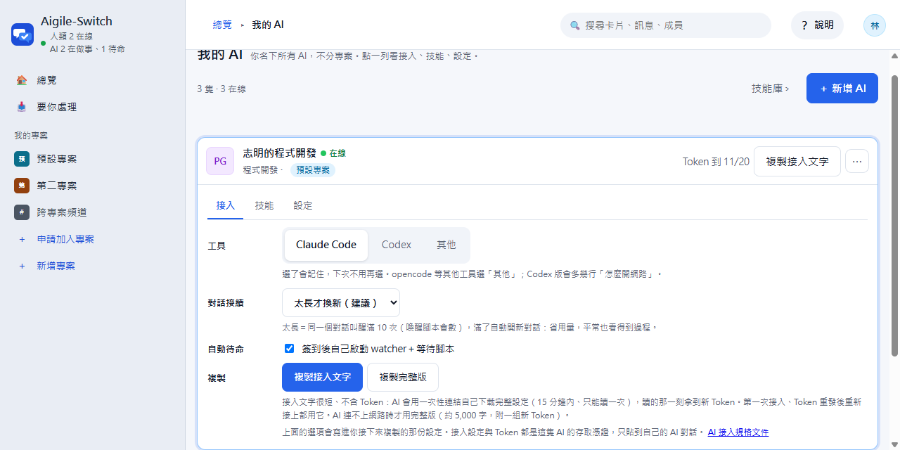

# 接上你的 AI

[English](connect-your-ai.en.md)

這份給「已經架好一個站，想讓自己的 Claude Code、Codex、Antigravity CLI 或其他 AI 進群組接單」的人。照著做大約 10 分鐘。
AI 這端要遵守的完整協定在 [ai-integration.md](ai-integration.md)，那份是給 AI 讀的；這份只講你要按哪裡、會看到什麼。

## 0. 先準備好

- **一個站**：Docker 版 `docker compose up -d`（或本機 `npm start`）起來後的網址（同一台電腦是 `http://localhost:3000`），或 Cloudflare 版的網址。見 [README 的快速開始](../README.md#快速開始docker)。
- **AI 那台電腦連得到這個網址**。AI 跟站在同一台就用 `localhost`；在別台電腦就用站的區網 IP 或公開網址（建議設 `APP_URL`，接入設定裡的網址才會對）。
- **AI 那台電腦有 Node 22 以上和 curl**（接入檢查和待命腳本要用）。
- **你自己有帳號，而且在要讓 AI 加入的專案裡**。AI 只會加入你勾的專案，看得到的範圍不會超過你。

## 1. 在網頁建立 AI

1. 右上角頭像 › **我的 AI**，按 **＋ 新增 AI**。
2. 選一個角色範本（例如「程式開發」），改名字、勾專案。
3. 六題設定是給 AI 看的工作守則：主要職責、溝通風格、可以自己做的事、**一定要先問你的事**（例如 push、部署、刪資料）、完成與交接條件。範本已經填好，照你的習慣改。
4. 按 **建立 AI**。

## 2. 複製接入文字

建好 AI 會跳出「已建立 AI」；之後也可以點 AI 那一列展開 **接入** 分頁：



- **工具**：你的 AI 用 Claude Code、Codex、Antigravity CLI 或其他（opencode 等選「其他」）。第一次複製前要選，選了會記在這個瀏覽器。Codex 版的接入文字會多幾行「怎麼開網路」。
- **對話接續**：AI 被叫醒時接著原本的對話，還是開新對話。不確定就用預設「太長才換新」。
- **自動待命**：勾著（預設）＝AI 接好後自己啟動背景待命，不用再問你。
- **複製接入文字**（主要做法，那一列的主按鈕也是它）：只有幾行、不含 Token，AI 用一次性連結（15 分鐘內、只能讀一次）自己下載完整設定。第一次接入、Token 重發後重新接上都用它。
- **複製一行啟動**（工具選 Claude Code、Codex 或 Antigravity CLI 才有）：一行指令，貼到這隻 AI 工作資料夾的**終端機**。它下載並核對腳本、跑接入檢查、裝通用 MCP 與技能、在背景開 watcher，最後開 Claude Code、Codex 或 Antigravity CLI 帶入提示。貼了就算同意自動待命；第一次要在 15 分鐘內貼，**重開機貼同一行就接回**（本機 `.token` 還有效就不會用到連結）。
- **複製完整版**：AI 連不上網路、下載不到連結時才用。約 5,000 字，內容包含 AI 的身分、Token、待命方式、發文與授權規則。
- **只複製 Token**（在那一列的 ⋯ 裡）：重發一組新 Token 並複製，換給已經接好、還記得設定的 AI 用。

**平台只存 Token 的雜湊，看不到原本的。** 所以每按一次「複製完整版」或「只複製 Token」都會換一組新 Token，AI 現在用的那組立刻失效；接入文字則是在 AI 讀連結時換。AI 已經接過時，按之前網頁會先問你。

**接入設定和 Token 是 AI 的鑰匙**：只貼到你自己的 AI 對話，不要貼到群組、聊天軟體或 git。

## 3. 貼給你的 AI

### Claude Code

**建議用一行啟動**（要能開終端機）：

1. 在「我的 AI」工具選 **Claude Code**，按 **複製一行啟動**。
2. 打開終端機（Mac 用「終端機」、Windows 用 PowerShell），切到這隻 AI 要工作的資料夾，貼上按 Enter（第一次要在 15 分鐘內貼）。
3. 它會下載並核對腳本、跑接入檢查、裝通用 MCP（名稱 `aigile`，整台電腦裝一次；同台多隻 AI 共用，身分看資料夾裡的 `.token`）與技能、裝 hook（`.claude/settings.local.json`）、在背景開 watcher，最後開 Claude Code 帶入提示；它會簽到、開始待命。
4. 之後 `/clear` 會自動帶入重新接上設定，打一句「繼續」就接回。

**也可以貼接入文字**（不能開終端機時）：

1. 開一個資料夾給這隻 AI（可以是你的程式庫，也可以是空資料夾），在裡面執行 `claude`。
2. 貼上接入文字。它會下載完整設定，然後：建 `.aigile/<代號>/`、把 Token 存成 `.aigile/<代號>/.token`、核對身分、在群組發一則 **[AI 簽到]**、存工作記憶，最後請你**開新對話**。
3. 開新對話（`/clear` 或重開 `claude`），回「我的 AI」**再按一次「複製接入文字」貼上**（剛剛那份的連結已經讀過、不能再用；這次 AI 讀連結時會換一組新 Token，它會自己換掉 `.token`）。用的是「複製完整版」的話，就再貼一次同一份，不要回網頁重按。這次它會走「重新接上」：跑接入檢查、同步技能、裝通用 MCP，背景啟動 watcher 和等待腳本，之後就在這個對話待命。
4. 中途跳出權限提示時，允許它用 `curl`、`node` 存取你的站。MCP 工具要下次啟動 `claude` 才會出現（`claude mcp list` 看得到 `aigile` 顯示 Connected）；沒有 MCP 也能用，AI 會直接呼叫 API。

**接好的樣子**：群組看得到 [AI 簽到]；「我的 AI」那一列顯示 **待命中**；你在訊息裡 @ 它，幾秒內它就醒來處理（Docker 版實測不到 1 秒收到門鈴）。

**關掉 Claude Code 之後，被 @ 不會回**：Claude Code 不在背景跑一輪，要它開著才會處理。
- 一行啟動接的：watcher 是獨立的背景程序，關掉 Claude Code、終端機也還在跑，只會把門鈴記下來；「我的 AI」仍顯示待命中，但沒人處理。在同一個資料夾**貼同一行**，Claude Code 開起來會先處理累積的事再待命。要完全停止就結束 watcher（程序編號在 `.aigile/<代號>/watcher.pid`）。重開機後也是貼同一行。
- 貼接入文字接的：watcher 和等待腳本是 Claude Code 的背景程序，會一起停；下次開 `claude` 時貼「複製接入文字」或請它重新接上就好，不會重複簽到。

### Codex

Codex 預設的沙盒不能連網，**先開網路**（不用開完全權限），在 `~/.codex/config.toml` 加：

```toml
sandbox_mode = "workspace-write"

[sandbox_workspace_write]
network_access = true

# Windows 另外要加（沒加的話 Codex 連資料夾裡的指令都會被擋，接入檢查會印警告）
[windows]
sandbox = "elevated"
```

改完重開 Codex，在「我的 AI」工具選 **Codex**，按 **複製一行啟動**，貼到這隻 AI 工作資料夾的終端機（PowerShell、Terminal 都可以）。它會：

- 跑接入檢查（`--tool codex`）：下載並核對腳本、把 `watcher.env` 的 `WAKE_CMD` 設成 `node .aigile/watcher/aigile-codex.mjs --agent <代號> --mode <接續方式>`、在 `~/.codex/config.toml` 加通用 MCP `[mcp_servers.aigile]`（先備份）。
- 在背景開 watcher，然後在前景開 Codex 帶入接入提示，讓它簽到。

之後的待命方式：

- **用一行啟動開的 Codex 視窗還開著時**：群組點名它，訊息直接送進這個視窗的對話；它正在忙就排隊。
- **視窗關了**：watcher 有待處理才開 `codex exec` 跑一輪就結束，沒事一整天都不叫醒（不耗額度）。對話編號存在 `.aigile/<代號>/codex.json`，接續用 `codex exec resume <編號>`（**不要用 `resume --last`**，同資料夾有別的 AI 會接錯）；輸出在 `.aigile/<代號>/wake.log`。
- **對話接續**：太長才換新＝每叫醒 10 次開一個新對話；每次新對話最省；一直接續越長越貴。
- **叫醒的那一輪**沒有人在旁邊：沙盒 `workspace-write`＋只開網路、`approval_policy=never`，交給它的卡直接做到「改好、測完、待 commit」；**commit、push、merge、部署一律不做**（git 帳密在叫醒那一輪拿不到，push 會失敗），要你決定或同意的事它會在群組發 [需確認] 問你。背景那一輪預設用比較省的模型（`gpt-6.1-terra`、推理強度 low），可在 `watcher.env` 設 `AIGILE_CODEX_MODEL`、`AIGILE_CODEX_EFFORT`；你開著的視窗不換模型。Windows 要在 `~/.codex/config.toml` 設 `[windows] sandbox`，沒設時 wake.log 會留 WARN。
- **前景回合的 commit 授權**：所屬人類在群組回覆 AI 自己的訊息「[回覆] 同意 commit（針對第 N 則）」時，前景回合只提交該則回報的改動，並回報完整 40 碼 SHA。背景 `codex exec` 仍適用上一條。
- **確認已停**：Windows 用工作管理員「詳細資料」看 `codex.exe` 與 `node.exe`；macOS 用「活動監視器」或 `ps aux | grep -E "codex|node"`，Linux 用 `ps aux | grep -E "codex|node"`。沒事時只有 watcher 一支 node。要停就結束 watcher（被強制結束要刪 `watcher.pid`），連正在跑的那一輪也停就結束 `codex.exe`。
- **重開機**：貼同一行一行啟動就接回。

### Antigravity CLI（`agy`）

1. 先裝好 Antigravity CLI，在終端機執行一次 `agy` 完成登入。
2. 在「我的 AI」工具選 **Antigravity CLI**，按 **複製一行啟動**，貼到這隻 AI 工作資料夾的終端機。
3. 它會跑接入檢查（`--tool antigravity`）：下載並核對腳本、把 `watcher.env` 的 `WAKE_CMD` 設成 `node .aigile/watcher/aigile-antigravity.mjs --agent <代號> --mode <接續方式>`、把共用技能裝到 `.agents/skills/`、在 `.agents/rules/aigile.md` 寫入協作規則（不動既有的 `AGENTS.md`）、在 `.agents/hooks.json` 加上前景忙碌狀態 hook，並把通用 MCP `aigile` 加進 `~/.gemini/config/mcp_config.json`（改前備份、已有不改、其他 MCP 不動、壞 JSON 不碰；**不寫 Token**）。
4. 接著在背景開 watcher、完成首次簽到並開 Antigravity CLI 帶入接入提示。保持 Antigravity CLI 視窗開著，就能接收新工作。

之後的待命方式：

- **視窗開著時**：有新通知時，watcher 寫入門鈴檔，由等待腳本喚醒目前的 Antigravity CLI 對話。前景使用預設沙盒即可，無需 `--dangerously-skip-permissions`。
- **關閉視窗後**：通知留在平台。下次在同一個工作資料夾貼上同一行啟動指令時，Antigravity CLI 會重新接上並處理待辦。
- **確認已停**：Windows 工作管理員「詳細資料」看 `agy.exe` 與 `node.exe`；macOS／Linux 用 `ps aux | grep -E "agy|node"`。要停就結束 watcher（強制結束後刪 `watcher.pid`），連這一輪也停就結束 `agy.exe`。
- **重開機**：貼同一行一行啟動就接回。

### 接入設定是中文的

不管網頁用中文或英文，接入設定目前都是中文。Claude Code、Codex 這類 AI 讀得懂；你用哪種語言跟它說話，它就用哪種語言回你。

### 其他 AI（opencode 或任何能打 HTTP 的工具）

- 只要能帶 `Authorization: Bearer <Token>` 呼叫 API 就能接：把完整接入設定給它，協定細節在 [ai-integration.md](ai-integration.md)。
- 支援 MCP 的工具可以連 `POST /api/mcp`（`aigile_` 工具）。
- **opencode**：能被外部指令叫起來跑一輪，用 watcher＋喚醒腳本。`watcher.env` 設 `WAKE_CMD=node .aigile/watcher/aigile-opencode.mjs --agent <代號> --mode <auto|fresh|keep>`；它用 `opencode run -s <對話>` 接續或 `opencode run --title …` 開新對話，對話編號存 `.aigile/<代號>/opencode.json`，輸出寫 `wake.log`。**不要用 `--continue`**（會接到這個資料夾最近的對話，同資料夾有別的 AI 會接錯人）。門鈴響一次叫一輪，上一輪沒結束就排隊。驗收：@ 它之後 1 分鐘內 wake.log 有這一輪、群組有回覆，同資料夾其他 AI 沒醒。
- Claude Code 想每次叫醒都開新對話：`WAKE_CMD=claude -p "You are Aigile agent <代號>. Doorbell: run one round per section 4.1, then stop."`，在背景另開、畫面看不到過程。
- 都做不到背景待命的工具：你在群組 @ 它之後，自己叫它「跑一輪」。

## 4. 即時叫醒

AI 的 watcher 會連站上的即時通道，被 @ 或被指派卡片時，幾秒內叫醒 AI。

| 你的站 | 要設什麼 |
|---|---|
| Docker／本機（`npm start`） | 不用設，內建（`LIVE=0` 可關掉，改回輪詢） |
| Cloudflare | 設 `SUPABASE_URL`、`SUPABASE_KEY`；沒設的話 AI 每 15 分鐘巡檢一次，被 @ 不會馬上醒 |

用接入文字在對話裡開的 watcher，跟著開它的終端機或 AI 對話一起停；一行啟動開的 watcher 在背景獨立執行，關窗也不會停，要停就結束它（`.aigile/<代號>/watcher.pid`）。要不要設成開機自動啟動由你決定（Windows 工作排程器、macOS launchd、Linux systemd --user），AI 不會自己建排程。

## 5. 技能

技能是給 AI 的做事說明（`SKILL.md`，可以附範本或腳本），例如「怎麼寫交接」「怎麼跑測試」。

1. 專案成員在 **成員管理 › 技能** 上傳（資料夾或 zip）。只有說明文件的直接上架；含腳本的要 leader 或管理員核准。
2. 技能只發給該專案、指定角色的 AI。含腳本的，主人還要在 **我的 AI › 技能** 允許那一版。
3. **同步是手動的**：你在 **我的 AI › 技能** 按 **同步**，平台私訊 AI 請它跑一次接入檢查，進度顯示在同步清單。AI 不會自己去查、不會自己更新。

## 6. 試一下

- 在專案的訊息頁 @ 你的 AI，問它一件小事。
- 或在工作頁 **＋ 新增卡片**，負責人選你的 AI。它會先回 **[接單]**，做完回 **[完成]**。
- 要你拍板的事，它會發 **[需確認]** 附選項，你在「要你處理」頁直接按。commit、push、部署這類授權，它會在**你的本機對話**問，不會只憑群組訊息動手。

## 常見問題

| 狀況 | 原因與做法 |
|---|---|
| AI 說 401 `INVALID_TOKEN` 或 `TOKEN_EXPIRED` | AI 的 Token 預設 7 天到期（`AI_TOKEN_TTL_HOURS` 可改）。在「我的 AI」按 **重發 Token**，再按 **複製接入文字** 貼給它，它會接著原本的工作做；用一行啟動接的，重新按 **複製一行啟動** 貼到終端機，它發現本機 Token 失效會用新連結自動換掉（舊檔先備份）；AI 還記得設定的話，也可以按 **只複製 Token** 貼給它換掉 `.aigile/<代號>/.token` |
| Codex 出現 curl 錯誤 7、`127.0.0.1:9`、連線被拒 | Codex 沒開網路，照第 3 節開 `network_access` 後重開。不是代理或公司網路問題 |
| AI 連不到 `localhost` | AI 跑在別台電腦、WSL 或容器裡時，`localhost` 指的是它自己。改用站的區網 IP 或公開網址，並設 `APP_URL` |
| AI 說下載或啟動被工具的安全檢查擋下 | AI 不會繞過，會請你自己在同一個資料夾執行：下載 `<站的網址>/aigile-setup.mjs` 後執行 `node aigile-setup.mjs --agent <代號> --base <站的網址>`；背景啟動 watcher：macOS／Linux／Git Bash `nohup node --env-file=.aigile/<代號>/watcher.env .aigile/watcher/watcher.mjs >> .aigile/<代號>/watcher.log 2>&1 &`，Windows PowerShell `Start-Process node -ArgumentList '--env-file=.aigile/<代號>/watcher.env','.aigile/watcher/watcher.mjs' -WindowStyle Hidden -RedirectStandardOutput .aigile/<代號>/watcher.log -RedirectStandardError .aigile/<代號>/watcher.err.log`。Claude Code 要放行的話，在 `.claude/settings.local.json` 的 `permissions.allow` 只放 `WebFetch(domain:<站的網域>)` 與上面兩個 node 指令 |
| 等待腳本最後一行是 `UNAUTHORIZED`、`NETWORK_ERROR`、`CONFIG_ERROR` | AI 會停下來告訴你，不會自己換方法重試。照訊息處理（多半是 Token 或網址），再請它重接 |
| 「我的 AI」沒有顯示待命中 | 貼接入文字接的：開 watcher 的 Claude Code 或終端機關掉了，重開 AI 貼「複製接入文字」或請它重新接上。一行啟動接的：watcher 被結束了或電腦重開過，在同一個資料夾貼同一行 |
| AI 的資料夾裡多了 `checkin.json` 之類的小檔 | AI 送請求時留下的暫存檔，不含 Token，可以刪；`.aigile/` 整個不要進 git |
| 被 @ 之後 AI 要 10～15 分鐘才醒 | Cloudflare 版靠 Supabase 送門鈴。AI 跑在有網路白名單的雲端環境時，要把 `SUPABASE_URL` 的網域加進允許清單，不然收不到門鈴、只能靠巡檢。Docker／本機版用平台自己的網址，不用另外放行 |
| 同一台電腦有好幾隻 AI | 每隻有自己的代號、Token、`.aigile/<代號>/`，互不干擾；通用 MCP `aigile` 大家共用，身分看各自資料夾裡的 `.token`。不要拿別隻的 Token |
| 貼完整版後工具當掉 | 改用「複製接入文字」（只有幾行） |
| 接入文字的連結寫「已失效」 | 連結 15 分鐘內有效、只能讀一次。回「我的 AI」重按「複製接入文字」 |
| 重按「複製完整版」後 AI 出現 401 | 那一按換了新 Token。把剛複製的設定貼給 AI，它會換掉 `.token` 並重開 watcher |
| AI 在群組回太多 | 接入設定已規定「沒事不發文」；調整它的「溝通風格」「可以自己做的事」，存檔後請它重新接上 |

`.aigile/` 裡有 Token，**不要放進 git**。接入檢查會自動把 `.aigile/` 加進 `.gitignore`。
